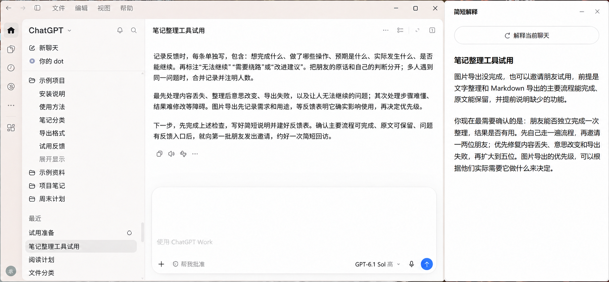
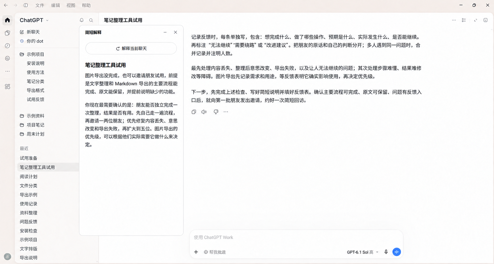

# Codex Reply Explainer · Codex 回复解释

English | [简体中文](README.md)

**This plugin uses Codex's official `thread/fork` API to create temporary branches, inherit the main chat's context, and reuse cached input where possible.** Explain Codex replies and ask follow-up questions in a separate floating window; explanations and questions stay out of the main chat.

Beta **0.5.0-beta.3** supports local Codex and local ChatGPT Work chats on Windows x64. Ordinary Chat, Work Cloud, and chats running on remote hosts are currently unsupported. This is a community project, unaffiliated with OpenAI.

All current features are maintained on [`main`](https://github.com/Jupiterofyear/codex-reply-explainer/tree/main). Installation and automatic updates follow that branch; no separate question-feature branch is required.

## Explanations and questions

The floating window now has **解释 (Explain)** and **提问 (Ask)** tabs. The window reads the selected sidebar conversation through Windows accessibility about once per second, without requiring a main-chat message or generating content. Click the bottom **解释当前对话 (Explain current conversation)** button to generate an explanation. Changing chats in the main window selects the corresponding floating-window chat tab. Manually selecting an older tab keeps it visible until the next main-window chat change; explanations and questions target that selected tab. A horizontally scrollable row below Explain/Ask retains each chat’s content, draft and reading position. Ask sends with Enter; Shift+Enter inserts a new line. Switching tabs preserves the text, question draft, and scroll position.

The first question forks the selected chat's latest complete saved context using its model and reasoning effort. Follow-up questions reuse that ephemeral branch while the main chat and Ask prompt are unchanged. After a new main-chat reply completes, the next question creates a fresh fork and imports the visible side-window Q&A once as quoted historical material, labeled with its source main turn. Past discussion does not establish current progress; the latest main-chat evidence controls facts and progress. By default, developer instructions require concise, informative answers without defensive boilerplate. **重新开始 (Start over)** clears the Q&A and discards the branch; the next question reads only the latest complete main-chat context. Rebinding or returning to a chat tab preserves its questions and branch; switching tabs lets existing generation finish. Closing the window clears all tabs and temporary branches. Restarting a crashed backend discards old questions without replaying them.

Explanations and questions have separate backends and ephemeral branches, so they can generate concurrently. During generation, Send becomes Stop; stopping preserves received text and allows follow-up. Thinking indicators follow backend events: before the first output and below a paragraph when reasoning resumes. Each active stage has a moving highlight and a live clock; completed stages keep their thinking duration, and completed or stopped answers retain total duration. Switching chats preserves the timer. Reduced-motion settings disable the highlight animation. Start over cancels only the active question. The composer and body follow Codex’s UI font size, and code follows its code font size; changes are picked up while the window is open. Question forks disable connector/MCP plugins, use a read-only sandbox, and reject interactive execution requests; the prompt asks the model to answer from existing context without tools. These tool settings can change the cached input prefix, so the historical explanation measurements below do not establish question performance. See [VALIDATION.md](VALIDATION.md) for local checks.

The floating window can shrink to 240 Windows logical units and Settings to 320 (about 360 and 480 screen pixels at 150% scaling). Narrow layouts trim titles, reduce side margins, shorten Settings tab labels, and place its action buttons on two rows. Wider windows restore the original layout; resizing does not reduce the configured font size.

## Custom prompts

Use the gear button at the top of the floating window to edit Explain and Ask prompts separately, save both, or restore the selected default. Settings apply to all chat tabs and persist in `prompt-settings.json` inside the configured data directory across window closure and plugin updates. Cancel discards unsaved edits. Each field accepts up to 32,000 characters; leaving it empty adds no custom answer requirements.

The **工作原理 (How it works)** tab is for reading: Restore, Cancel, and Save are all hidden and disabled, giving the explanation more space. Returning to either prompt editor restores the buttons and preserves unsaved edits. Use the top-right close button to leave the settings window.

Prompts describe how to answer; inherited conversation context supplies the discussion material. Explain sends the basic explanation request plus the editable requirements as the current user request. Changing its prompt allows the same completed main reply to be explained again. Ask supplies the editable requirements as developer instructions when creating its branch, above ordinary user messages. A new completed main reply or a changed Ask prompt creates a fresh branch on the next question, carrying visible side-window Q&A as historical material. Separate fixed instructions distinguish old discussion from current progress. Changing only Explain does not rebuild Ask. Saving does not interrupt active generation or rewrite previous answers.

The **工作原理 (How it works)** tab explains instruction priority, context, history, effective timing, and prompt-writing examples. Be explicit and avoid contradictory or repetitive requirements. Empty Explain still sends a basic explanation request, and empty Ask keeps history-attribution rules. Prompt text does not change tool permissions or override higher-priority model/environment instructions. See the [official prompting guide](https://developers.openai.com/api/docs/guides/prompt-engineering).

## Interface preview

These screenshots show an earlier explanation page. The current version also includes Ask, chat tabs, thinking timers, and a Stop button.

Edited from a real full-window screenshot, with chat names, project names, and avatar initials replaced. The text comes from an actual generation for a fictional scenario: a 708-character original reply and its 168-character explanation. The main chat shows the latter part of the long reply, while the floating window shows the complete explanation. Both appear near the top.





Click the image to view the full-size version, or read the [complete example reply and explanation](assets/screenshots/example-content.json). The screenshot has undergone content replacement and image editing.

## How it works

- Select a chat. The plugin reads its locally saved history through the latest completed reply.
- It creates a temporary fork from that history, keeping the original model and reasoning effort and reusing cached input where possible. If the conversation has been compacted, it inherits the context that remains after compaction.
- The backend starts and is reused automatically. Explanations are generated only after clicking the bottom button.
- Explanations and questions appear only in the floating window. Chat tabs retain their contents when switching. Closing the window clears all temporary contents and backends while preserving window geometry. Temporary copies of context and authentication data are removed after generation.
- Supports Markdown and common mathematical notation.
- **Remembers the window size and screen position when closed, and restores them the next time it opens.**

## Temporary forks, also used by official composer predictions

A fork is an independent branch of an existing conversation that carries its context into a new generation. Codex's official composer predictions also use temporary forks to generate suggestions. This plugin calls the official `thread/fork` interface with `ephemeral: true`. The temporary fork runs in memory and is not added to the list of permanently saved chats. See the [official App Server documentation](https://learn.chatgpt.com/docs/app-server).

The explanation fork inherits the effective context through the latest completed reply. It can therefore explain that reply using earlier questions, constraints, interests, and preferences expressed in the conversation. For compacted history, it uses the content that remains effective after compaction. The original model and reasoning effort are preserved.

The forks are created from different sources: the official composer prediction implementation we inspected forks the chat state already loaded by the desktop app. This plugin creates a temporary fork from saved local records in its own backend. The plugin automatically manages backend startup, reuse, and shutdown while the main chat continues independently. The calls are in [src/backend.mjs](src/backend.mjs).

## Measured input cache reuse

Preserving existing context and model settings lets the server reuse matching input it has already processed. **An automatic explanation immediately after a new reply using 0.5.0-beta.2 returned a 93.5% input cache hit rate.** Earlier measurements are retained below for comparison.

| Request | Total input tokens | Cached input tokens | Cache hit rate |
|---|---:|---:|---:|
| beta.1 first explanation | 159,146 | 148,992 | 93.6% |
| beta.1 second explanation | 187,980 | 178,048 | 94.7% |
| beta.2 automatic explanation after a new reply | 156,592 | 146,432 | 93.5% |

A token is a unit used to measure model input and output. The hit rate is calculated as **cached input tokens for this request / total input tokens for this request**, using the server's returned counts. These requests inherited the main chat's `gpt-6.1-sol` model and high reasoning effort.

These are local measurements. Actual cache reuse varies with the input, model, and cache retention. Each explanation still generates new content and counts toward the usage of your account or service. See [VALIDATION.md](VALIDATION.md) for counts and test conditions, and the [official prompt caching guide](https://developers.openai.com/api/docs/guides/prompt-caching) for the caching mechanism.

## Measured speed

On October 18, 2026, version 0.5.0-beta.1 explained two completed replies from the same chat. Its timings were compared with the official composer prediction result logs for those same replies:

| Source reply | Official composer prediction | Complete explanation from this plugin |
|---|---:|---:|
| Reply A: first explanation | 14.8 s | 26.5 s |
| Reply B: subsequent explanation, backend reused automatically | 18.5 s | 18.2 s |

Official timings run from completion of the main reply to the prediction result being logged. Plugin timings run from submitting the explanation request to the complete result being updated; initial backend startup had already finished before submission. The requests occurred at different times, and neither measurement tracked when pixels appeared on screen. The official feature generates a suggested next message; the plugin generated explanations of 132 and 144 characters in these tests, displaying text progressively as it arrived. See [VALIDATION.md](VALIDATION.md) for detailed timings.

On October 22, 2026, the version containing these fixes automatically started an explanation about 1.1 seconds after a new reply finished. The complete result was updated 24.4 seconds after the main reply, with a 93.5% cache hit rate. No matching official prediction timing was available for this measurement; the table above remains a historical comparison.

**Backend startup, reuse, and shutdown are already handled automatically. No separate switch or configuration is needed.** Actual times vary with context length, the inherited model and reasoning effort, server response, and network conditions.

## Requirements

1. Windows 10/11 x64, with the Codex desktop app installed and signed in.
2. Node.js **22.13 or later**, with `node.exe` available on `PATH`.
3. Codex's `codex.exe` available on `PATH`, or its full path supplied to the installer. Use a version supporting `plugin marketplace` and `thread/fork`.
4. Git is on PATH and GitHub is reachable.
5. Microsoft WebView2 Runtime already installed. The package includes the required WebView2 SDK components, but not the browser runtime.

## Install with help from your own Codex

**New users can install the latest version directly. Users of beta.1 / beta.2 can run the new installer once to enable automatic updates, without uninstalling first.** Download the asset ending in `-plugin-windows-x64.zip` from [Releases](https://github.com/Jupiterofyear/codex-reply-explainer/releases).

Send the project URL and this request to your own Codex:

> Please install or update Codex Reply Explainer and enable automatic updates. Read README, PRIVACY.md, and install.ps1 first. Check the Windows, Node.js, Git, Codex, and WebView2 requirements. Download the latest Windows x64 plugin ZIP, extract it to a permanent folder I choose, and run the installer. For an existing installation, retain its Codex storage directory, explanation data directory, and window size and position. This version requires no lifecycle hook approval. Restart Codex, then verify the installed version, opening menu, and automatic chat selection plus explanations after clicking the button. Do not modify the desktop app's source code.

The installer registers this project's GitHub main branch as the plugin source. Codex downloads and updates the runtime files. Installation gets the current build on that branch, including the Explain and Ask features described here. Machine-specific settings are stored separately, and window geometry stays in the existing explanation data directory.

### Install it yourself

1. Close the floating window and extract the latest Windows x64 plugin ZIP to a permanent folder.
2. Open PowerShell in that folder:

   `powershell -NoProfile -ExecutionPolicy Bypass -File .\install.ps1`

   For a first installation, optionally choose the explanation data directory:

   `powershell -NoProfile -ExecutionPolicy Bypass -File .\install.ps1 -DataDirectory "D:\ReplyExplainerData"`

   For an existing public release, omitting `-DataDirectory` preserves the original data directory. Use `-CodexHome` for the Codex storage directory of the previous installation, and `-CodexPath` if Codex is not on PATH. Node.js and Git must be on PATH.
3. Reopen the Codex desktop app. This version registers no lifecycle hooks and requires no hook approval.
4. Open the floating window and check window geometry and automatic chat selection plus explanations after clicking the button.

Installation writes to:

| Location | Purpose |
|---|---|
| Configuration, plugin sources, and cache in the Codex storage directory | Official registration, automatic-update downloads, and runtime copies |
| `plugins/reply-explainer-settings.json` in the Codex storage directory | Machine-specific data directory and Codex executable location; retained across plugin updates |
| Selected explanation data directory | Temporary explanations, diagnostic logs, and window geometry |
| `.local` inside the extracted folder | Launcher information, installation receipt, and temporary installation files |

A first installation defaults to `.local/data` inside the extracted folder. Existing installations retain their data directory. If it lives inside an older extracted folder, keep that directory. The installer does not modify desktop source code.

## Open and use

Open the floating window from within Codex: use the plus button beside the conversation, then select **Codex 回复解释（悬浮窗）** in the new tab's tools. No desktop shortcut or automatic startup is required. Selecting the same entry again restores a minimized window and preserves its contents instead of opening another copy.

The plugin's interface currently uses Chinese labels. Their English meanings are included below.

1. Open the local chat you want to explain. In the **top-right corner of the chat area, select “+”, then “Codex 回复解释（悬浮窗）” in Tools** to open the floating window.
2. The window selects that chat and waits for the bottom explanation button to be clicked. Opening it from this menu selects the chat directly. You can close the accompanying internal panel and keep the floating window open. If you retain the panel, its “打开悬浮窗” (Open floating window) button reopens the window directly.
3. Select **提问 (Ask)** to ask questions using this chat’s context. Enter sends; Shift+Enter inserts a line break. During generation, the send arrow becomes a Stop square. Stopping keeps received text and permits follow-up. Thinking indicators appear before the corresponding output and update their elapsed time each second.
4. **Changing the main-window chat selects its floating-window tab automatically.** Keep one main window open with its selected sidebar chat visible. Clicking an older tab lets you read its explanations and Q&A and continue working with that chat; automatic following resumes on the next main-window chat change. Recognition uses no focus changes, keystrokes, or clipboard access.
5. Sending main-chat messages or changing chats does not generate explanations. Click the bottom explanation button when needed.
6. Move and resize the window as needed. **Closing it saves its size and screen position for the next launch**, stops both backends, and clears temporary contents from all chat tabs. If the backend exits unexpectedly, the window retains the partial text and shows an error. Click “解释当前对话” (Explain current conversation) to restart the backend and generate the explanation again.

Another way to open it: after installation, double-click `open.cmd` in the extracted folder, then click “解释当前对话” (Explain current conversation). The launcher locates the currently installed version and uses the existing data directory.

Chats opened before an update may retain a failed plugin connection. If the panel still cannot be displayed after updating, wait for running tasks to finish, fully quit and reopen Codex, then use the same entry. The panel's Retry button may keep using the old connection.

If the name does not follow navigation, check that the selected sidebar chat is visible and has a unique name; the window shows the specific error. Explanations require clicking the bottom button. Ordinary Chat does not provide the local records required by this version; the plugin does not convert it into a new main chat.

## Automatic updates and uninstalling

Starting with **0.5.0-beta.3**, the installer enables Codex's official Git marketplace updates by default.

- **New users:** install once.
- **beta.1 / beta.2 users:** close the floating window, run the new installer once, and restart Codex. The installer preserves the existing explanation data directory and window geometry.
- **After that:** when the Codex backend starts, it checks the GitHub main branch, downloads changed plugin files, and refreshes the installed copy. Reopening Codex triggers a check; GitHub must be reachable. Close and reopen an existing floating window to load the new version.
- This version reads the selected sidebar conversation and registers no lifecycle hooks.

Updates follow `.agents/plugins/marketplace.json` and `plugin/` on main. **Uploading Release assets alone does not trigger an automatic update.** Publishers must also commit the built, tested installation files to main. See [CONTRIBUTING.md](CONTRIBUTING.md) for the release workflow.

Updates retain the data directory and window size and position. The plugin installs no additional persistent updater. Codex handles checking and downloading; delivery is not immediate for every user, and open windows are not forcibly closed.

### Uninstall

```powershell
codex plugin remove reply-explainer@reply-explainer-preview
codex plugin marketplace remove reply-explainer-preview
```

You can then delete the extracted folder, your selected explanation data directory, and `plugins/reply-explainer-settings.json` in the Codex storage directory. If installed with a custom `CODEX_HOME`, uninstall using the same environment.

## Build from source

Run these commands in the project directory:

```powershell
npm ci --cache .local/npm-cache
npm run build
npm test
npm run package
```

Building requires the Windows x64 .NET Framework C# compiler. Required WebView2 SDK files and licenses are in `vendor/webview2`. Building also prepares plugin/ and .agents/plugins/marketplace.json for automatic updates. Other output stays inside the project's `dist` and `.local` directories; packages are written to `.local/releases`.

## Current limitations

This version depends on local record formats, database structure, and Codex's fork interface. Desktop updates may require adjustments. It preserves effective conversation history, while its separate explanation backend does not reproduce every part of the desktop backend's running state. Cache hits are measured using the server's returned counts.

This beta is distributed as source code and a manually installed package. This version registers no lifecycle hooks. See the [official plugin documentation](https://developers.openai.com/plugins/build/plugins).

## Privacy and licenses

Data handling is described in [PRIVACY.md](PRIVACY.md). Project code is licensed under [MIT](LICENSE). Third-party components retain their own licenses; see [THIRD_PARTY_NOTICES.md](THIRD_PARTY_NOTICES.md) and `dist/licenses` in the installation package. The supporting project documents are currently in Chinese.
